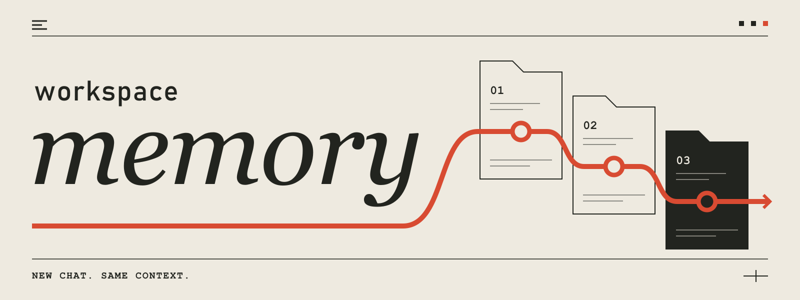

**简体中文** · [English](README.en.md)

新开对话，直接继续工作，不用手动交接。

Workspace Memory 是一个基于 Markdown 的工作区记忆 skill。启用后，Agent 在工作中记录重要背景、决定和进度。新会话打开同一个工作区，就能按任务读取这些记忆。你直接说下一步要做什么，不必先回到旧对话生成摘要，再复制过来。

它可以用于编程、服务器运维，也可以用于研究、写作或长期学习。记忆就是工作目录里的 Markdown 文件，使用 Obsidian 兼容的双向链接；不需要安装 Obsidian、MCP 服务或向量数据库。

[适用场景](#适用场景) · [安装](#安装) · [开始使用](#开始使用) · [使用示例](#使用示例) · [验证](#验证与示例)

## 它解决什么问题

长期和 AI 一起工作时，文件和成果通常还在，做决定时的上下文却留在旧聊天里：

- 新会话不知道哪些工作已经完成，哪些结论还待核实，哪些成果尚未交付。
- Agent 建议改掉某个做法，却不知道你当初为什么这样决定。
- 交接摘要越写越多，新旧结论并存，很难判断现在应该相信哪一条。
- 切换 Agent 后，需要再次说明同一套背景、操作约束和未完成事项。

Workspace Memory 把这些上下文留在工作区，并给 Agent 一套读取、更新和处理旧决策的规则。换对话时，背景知识跟着工作区走。

## 适用场景

工作区可以是一个普通文件夹，不要求有代码，也不要求使用 Git。只要工作会跨越多个会话，而且下一次需要用到之前的事实、决定或进度，就值得保留这些记忆。

- 软件开发：保留架构与接口约束、产品决定、测试结果，以及尚未部署或验收的工作。
- 服务器运维：为服务器建立维护目录，积累服务清单、配置位置、备份与恢复流程、故障处理经验和待办。
- 研究分析：保存资料出处、研究问题、实验条件、已获证据和未验证假设，避免把初步判断当成定论。
- 内容创作：延续目标读者、风格约定、素材来源、编辑决定和审阅进度，换会话后不必重新对齐要求。
- 长期学习：记录已掌握的内容、常见误区和练习进度，下次从当前水平继续。

按任务划分主题即可，不必套用编程项目的结构。一次性问答通常用不到它；如果几条固定说明就能交代清楚，普通 `AGENTS.md` 也可能够用。这个 skill 不提供跨项目语义搜索、云端同步或聊天记录自动采集。

## 为什么不需要手动交接

### 工作时更新，新会话按需读取

工作有了实质进展，Agent 就更新相关记忆，不必等到对话结束再写总结。新会话先看当前状态，再找到任务需要的主题。例如修改认证逻辑时，不用把部署记录和设备协议都读一遍。API 路径、字段名、版本和兼容条件仍保留在各自的主题里。

### 保留决定的理由，减少重复改错

修改或审查某个行为前，Agent 先读相关决定和理由。决定变了，就一起修改旧结论和引用它的主题；只有部分条款失效，就保留其余仍然有效的要求。

### 当前状态按事项更新，不累积交接日志

做完的事从当前待办中移出，有用的结果留在对应主题。待核实、待交付、被外部条件卡住的事项继续保留，并写清下一步。这样，新会话不必从一长串历史进度中猜测现在该做什么。

### 文件可检查，也能随项目迁移

记忆是普通 Markdown，你可以搜索、编辑、比较差异，也可以把它纳入版本控制。更换支持该 skill 的 Agent 时，保留工作区文件并安装 skill 即可，无需搬迁数据库。

## 安装

推荐直接发以下指令，让 Agent 帮你安装。已下载源码时，也可以把仓库地址换成本地绝对路径：

```text
请从 https://github.com/sleepyquq/workspace-memory 安装 workspace-memory，供我在不同工作区使用。
安装时保留仓库中的 LICENSE 文件。
安装后确认它可以被加载；如果已有同名版本，先询问我是否替换。
本次只安装 skill，暂不在任何工作区启用记忆。
```

Agent 负责安装位置和文件操作。如果它提示需要刷新或重启，完成后再确认 skill 可用，然后到目标工作区启用记忆。

使用这个 skill 的 Agent 需要能加载 skills、读取工作区根目录的 `AGENTS.md`，并读写工作区文件。希望自己管理安装文件时，可以使用[手动安装指南](docs/manual-installation.md)。

## 开始使用

### 1. 在目标工作区中启用

在 Agent 中打开要持续工作的目录，对它说：

```text
使用 workspace-memory，为当前工作区启用记忆。
如果已有项目记忆，先检查并迁移，保留有效内容。
```

Agent 会检查已有文件，创建或迁移记忆，并在工作区根目录的 `AGENTS.md` 中登记入口。默认会创建 `.workspace-memory/`，入口状态为 `Status: enabled`；已有的有效自定义记忆路径会保留。

安装 skill 不会自动启用所有项目。已有 `.workspace-memory/` 文件夹，也不等于已经启用。

### 2. 正常交代工作

```text
继续整理这份研究报告，补齐结论的证据，暂不发布。
```

在已启用的工作区中，skill 要求 Agent 在实质工作前读取相关记忆，有进展后更新受影响的知识。你不必每次重复 skill 名称，也不必在结束会话前单独要求它准备交接材料。

### 3. 新开对话，直接交代下一项任务

在新会话中打开同一个工作区，直接说：

```text
给报告补上风险分析部分，沿用已经确认的研究范围。
```

Agent 会找到已有的研究范围、相关决定和当前进度，再开始工作。你不用粘贴上一轮总结，也不用先发一条“恢复记忆”的指令。记忆会区分已核实的事实、待验证的判断和未完成的审阅，不把初稿当成最终成果。

## 使用示例

在已启用记忆的工作区里，新会话可以这样开始。

### 软件开发：接着改功能，保留原有约束

导出功能已经通过本地测试，还没部署；旧版文件格式仍需兼容。新会话直接交代：

```text
给导出功能加上失败重试，先做本地测试，不要部署。
```

Agent 会从相关主题中找到兼容要求和已有测试结果。完成后，重试功能的进展会更新到记忆中，未部署状态也会继续保留。

### 服务器运维：在同一个目录里积累维护经验

新建一个普通目录，例如 `server-ops/`，在 Agent 中打开它。提供服务器的别名、用途、系统版本和你已有的运维资料，再提出：

```text
这个目录用于维护我的服务器，请启用 workspace-memory。
根据我提供的基本信息和运维资料建立记忆，整理服务清单、配置位置、维护约束和待办。
没有确认的信息标为待核实。这次只整理记忆，不连接或修改服务器。
```

排障、配置调整和恢复演练中确认的信息，会逐渐积累在这个目录里。下次新开对话，直接说：

```text
继续处理备份告警。
```

Agent 会查阅已有的排查结论和未完成事项，不需要你重述服务器情况。

服务状态、配置和备份结果会变化，实际操作前仍要核实相关信息是否最新。密码、私钥和访问令牌应留在凭据管理工具中，不写入记忆。

### 研究分析：沿用实验条件，继续追问

工作区里已有资料来源、样本范围和第一轮分析结果，其中一组异常值还没解释清楚。

```text
把上次发现的异常值单独分析，看看是否会改变结论。
```

Agent 能沿用已记录的实验条件，追溯原始资料，并把新的观察与尚未证实的解释分开记录。

### 内容创作：接着写，不再重复风格要求

系列文章的目标读者、语气和术语写法已经确定，前两篇也完成了审阅。

```text
接着写第三篇，先给我提纲和开头。
```

Agent 会按已经确定的受众和写法续写，并使用记忆中记录的素材出处。

### 长期学习：从上次的薄弱点继续

学习目录里记录了已经掌握的概念、练习中的易错点，以及还没完成的部分。

```text
继续练习条件概率，出三道题，先不要给答案。
```

Agent 可以根据已有学习记录选择题目；后续有新的掌握情况，再更新相关记忆，而不是每次从第一章开始。

## 日常维护怎么说

| 你要做什么 | 可以直接提出的请求 |
| --- | --- |
| 只读检查 | 检查当前工作区记忆的结构、链接和冲突，先不要修改。 |
| 整理过长状态 | 整理当前记忆，收敛历史进度，保留未完成事项和决策依据。 |
| 迁移旧记忆 | 把现有 AGENTS.md 中的项目记忆迁移为 workspace-memory，保留有效细节和精确标识符。 |
| 查看某个主题 | 总结当前认证设计，以及相关决定为什么这样做。 |
| 停用 | 停用当前项目的 workspace-memory，保留已有笔记。 |

停用会把项目入口改为 `Status: disabled`，不会删除记忆。检查和总结默认只读；修复、整理或迁移需要相应的修改授权。

## 工作方式

```text
your-project/
├── AGENTS.md
└── .workspace-memory/
    ├── state.md        当前目标、未解决问题和下一步
    ├── index.md        按任务关键词查找知识归属
    ├── topics/         事实、资料来源、方法和约束
    └── decisions/      决定、理由、适用范围和替代关系
```

入口只放当前状态和查找线索，详细内容放在各自的主题里。普通任务按需读取；迁移、完整检查和结构校验才需要遍历图谱。Obsidian 可以展示这些双向链接，Agent 直接读 Markdown 即可。

例如，编辑器规定顶部撤销只影响当前条目，任务卡片负责撤销整次 AI 任务。审查功能时，Agent 先读这项决定，再检查实现是否符合要求。用户改变决定后，记忆会标明哪些旧条款已被替代，避免两套规则同时生效。

提交、发布、远程操作和数据修改仍按用户授权执行，记忆本身不授予这些权限。这个 skill 不另设云端存储；Agent 读取的内容仍按所用运行时和模型服务的数据规则处理。

## 验证与示例

可以先阅读 [合成示例项目](examples/editor-workspace/AGENTS.md)，再决定是否在自己的项目中启用。它展示了部分决策替代，以及本地已修复、生产仍待发布的状态如何共存。

校验脚本需要 Python 3.10+，仅使用标准库。在 skill 仓库根目录运行：

```sh
python -m unittest discover -s tests -v
python scripts/validate_memory.py examples/editor-workspace
```

检查自己的项目时，把最后一个路径换成项目根目录。校验器只读，检查入口、路径、元数据、链接、可达性和决策替代关系。退出码 `1` 表示结构错误；`0` 表示结构检查通过，仍可能附带需要整理或核对的警告。它不能代替 Agent 判断一条决定是否仍然适用。

[独立会话接续案例](tests/continuation.md)记录了复现输入、验收标准和实际结果。第一个会话修改合成编辑器并整理记忆，第二个会话不继承聊天历史，仅凭项目文件恢复产品决定和未完成事项。检查涵盖了已确认行为是否被误改，以及整理状态后是否仍保留部署、验收和外部依赖。验证使用同一执行环境中的两个独立上下文，未覆盖其他运行时或 skill 自动发现。

## 进一步阅读

- [SKILL.md](SKILL.md)：Agent 实际遵循的读写规则。
- [维护规则](references/maintenance.md)：决策冲突、部分替代和状态收敛。
- [图谱结构](references/knowledge-graph.md)：笔记字段、路由与双向链接。
- [迁移流程](references/migration.md)：迁移覆盖检查与精确标识符审计。
- [校验说明](references/validation.md)：支持的格式、诊断和检查边界。
- [MIT 许可证](LICENSE)：使用、修改和再分发条件。
